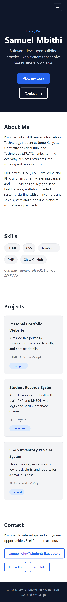

# Personal Portfolio Website

A responsive portfolio website showcasing my projects, skills, and contact details.

🔗 **Live site:** https://mbithi-sam.github.io/portfolio/

## Features
- Fully responsive layout for phones, tablets, and desktops
- Mobile navigation menu built with JavaScript
- Smooth-scroll navigation between sections
- Project cards showing status and tech stack
- Contact links for email, LinkedIn, and GitHub

## Built with
- HTML5
- CSS3 (Flexbox, Grid, CSS variables, media queries)
- JavaScript (DOM manipulation)

## Run it locally
1. Clone the repository:
   `git clone https://github.com/mbithi-sam/portfolio.git`
2. Open the `portfolio` folder
3. Open `index.html` in your browser (or use the VS Code Live Server extension)

## What I learned
- Structuring a multi-section page with semantic HTML
- Building responsive layouts with Grid, Flexbox, and media queries
- Using CSS variables to keep styling consistent
- Writing JavaScript to toggle a mobile menu
- Using Git commits to track progress, and deploying with GitHub Pages

## Future improvements
- Add a working contact form
- Add dark mode
- Link each project card to its repository and live demo

## Contact
Samuel Mbithi · [LinkedIn](https://www.linkedin.com/in/samuel-mbithi-b5b852303) · samuel.john@students.jkuat.ac.ke